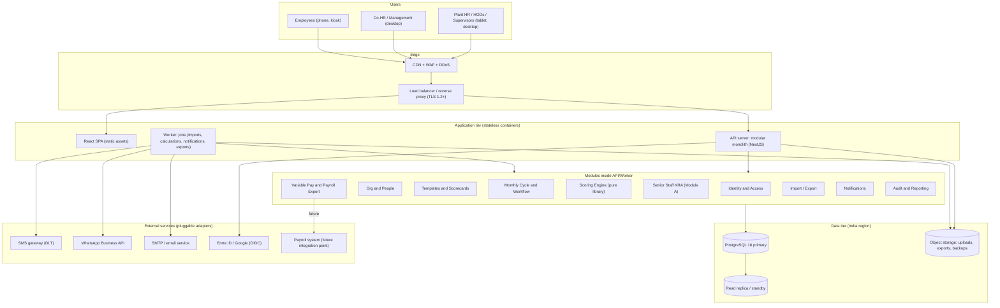

# 01 · Architecture and Technology Stack

## 1. Design principles

- **Boring, proven technology**, operable by a small team in Chennai.
- **Correctness of money-adjacent numbers over feature breadth.** Scores feed pay, so determinism, versioning, locking and audit come first.
- **Config over code**, **effective-dating everywhere**, **least privilege**, **India data residency**.
- **Tablet-first responsive UI**, bilingual (English/Tamil) from day one.

## 2. Architecture overview

### Component responsibilities

| Component | Responsibility |
|---|---|
| **React SPA** | UI for all roles, i18n (en/ta), offline-tolerant forms, tablet layouts, client-side *preview* scoring (same library, never authoritative). |
| **API server** | Authentication, authorisation (policy engine), REST endpoints, validation, workflow transitions, synchronous scoring preview. Stateless; horizontally scalable. |
| **Worker** | Long-running or scheduled jobs via pg-boss: Excel import parsing/validation, official calculation runs, bonus runs, report/export generation, notifications, reminders and escalations. |
| **Identity and Access** | Users, credentials, MFA, sessions, SSO, roles, scoped assignments, delegation, login audit. |
| **Org and People** | Org tree, plant types, employees, categories, effective-dated assignments and reporting lines, people-level assignments, bulk import. |
| **Templates and Scorecards** | KRA templates per plant type and senior role, per-plant/unit scorecards, versioning, weight validation. |
| **Monthly Cycle and Workflow** | Period management, submission state machine, maker-checker, deadlines, reopen. |
| **Scoring Engine** | Pure library: KRA score, level score, quarter/year roll-up, employee score. Versioned parameters. No I/O. |
| **Senior Staff KRA (Module A)** | KRA/KPI authoring, acknowledgement, monthly entry, quarterly/yearly roll-up, mid-year changes. |
| **Variable Pay** | Bonus/incentive rule sets, eligibility, payout calculation, payroll batches, approval, export, adjustment batches. |
| **Import/Export** | Layout profiles, staged validation, error workbooks, payroll/PMS/summary exports. |
| **Notifications** | Template-based multi-channel (email, SMS, WhatsApp, in-app) behind one adapter interface. |
| **Audit and Reporting** | Append-only hash-chained audit log, dashboards from rollup tables. |

### Why a modular monolith

| Concern | Decision |
|---|---|
| Scale | Peak ≈ 200 concurrent users, a few thousand result rows per month. A single well-indexed Postgres is far below its limits. |
| Consistency | Lock → bonus → export must be transactional and auditable; a single DB gives ACID without sagas. |
| Team and ops | One deployable, one DB, one log stream. |
| Future | Each module owns its tables and exposes a TypeScript interface. Extraction (for example notifications) remains possible. |

## 3. Recommended stack

| Layer | Recommendation | Why | Alternatives considered |
|---|---|---|---|
| **Frontend** | React 18 + TypeScript + Vite, Tailwind, TanStack Query/Table, react-hook-form + zod, Recharts, **i18next** (en/ta) | Reuses the existing demo UI; strong table/form ecosystem; first-class i18n | Angular (heavier, good for large teams); Next.js (SSR is not needed behind login) |
| **Backend** | **Node.js 20 + TypeScript + NestJS** | Same language as the frontend, so the scoring library is shared and tested once; modular DI structure suits the monolith; large talent pool in India | .NET 8 (excellent if the client is a Microsoft shop); Java Spring Boot (heavier); Django (fast admin, weaker shared-logic story) |
| **Database** | **PostgreSQL 16** | `daterange` + `EXCLUDE USING gist` for effective-dating, RLS, JSONB for rule parameters, `ltree` for the org tree, PITR | SQL Server (if on-prem MS shop); MySQL (weaker constraints) |
| **Data access** | Prisma for CRUD plus hand-written SQL migrations for exclusion constraints, RLS, triggers and rollup views | Type safety without hiding the constraints that matter | Drizzle, Kysely, TypeORM |
| **Jobs/queue** | **pg-boss** (Postgres-backed) | No extra infrastructure, transactional enqueue | BullMQ + Redis (add only if volume grows) |
| **Auth** | In-house module using **Argon2id**, TOTP, SMS OTP, **server-side sessions** (HttpOnly, SameSite cookies) and OIDC for SSO | Revocable sessions, forced logout, simple device management | Keycloak (good if SSO/MFA breadth is needed, but extra ops); Auth0/Entra B2C (data residency and cost concerns) |
| **Excel** | exceljs (streaming read/write) | Handles .xlsx with styles, used for error workbooks | SheetJS CE |
| **Files** | S3-compatible object storage (versioned, SSE-KMS) | Uploads, exports, error reports | Azure Blob |
| **Notifications** | Adapter interface; email via SMTP/SES; SMS via DLT-registered Indian gateway; WhatsApp via approved BSP | Pluggable per requirement | n/a |
| **Observability** | OpenTelemetry → Grafana stack or cloud-native; Sentry for frontend errors | Vendor-neutral | Datadog, New Relic |
| **IaC/CI** | Terraform; GitHub Actions or Azure DevOps; Docker | Reproducible environments | n/a |

### Shared libraries (monorepo packages)

- `@mmf/scoring`: pure TypeScript, zero dependencies, used by the API, the worker and the SPA preview. **Golden-file tested against the client's Excel sheets.**
- `@mmf/rules-schema`: JSON Schemas (zod) for scoring and bonus rule definitions.
- `@mmf/domain-types`: enums and DTOs shared by both sides.

## 4. Hosting: cloud (India region) vs on-premise

| Criterion | Cloud, India region (recommended) | On-premise (client datacentre) |
|---|---|---|
| Data residency | Yes: Azure Central/South India or AWS Mumbai (ap-south-1) with Hyderabad (ap-south-2) for DR | Yes |
| Availability | Managed Postgres with multi-AZ, automated PITR | Needs the client's own HA, backup and DR effort |
| Time to deliver | Days | Weeks (procurement, hardening) |
| Security patching | Shared with the provider | Fully client-owned |
| Cost | Opex; low at this scale (~2 app containers, 1 managed DB, storage) | Capex plus staff time |
| Suitability | Best for a small IT team | Choose only if policy forbids cloud |

**Recommendation:** managed cloud in an Indian region. The design is container-based, so the same images run on-prem (Docker Compose or a small Kubernetes cluster with self-managed Postgres + pgBackRest) if the client insists. See doc 10.

## 5. Cross-cutting design rules

- **Idempotent, transactional state changes**: each workflow transition is a single DB transaction that writes the state, the audit entry and the notification outbox row together (transactional outbox).
- **Optimistic concurrency**: `version` column on mutable aggregates; `If-Match` on updates.
- **Time**: stored as UTC `timestamptz`; business periods as `YYYY-MM`; displayed in IST.
- **Soft delete**: only for reference data (deactivate). Facts, scores and audit are never deleted.
- **Feature flags**: per-module toggles so phases (doc 11) ship dark and enable per plant.
- **Pilot rollout**: enable plant by plant (feature flag per org unit).
