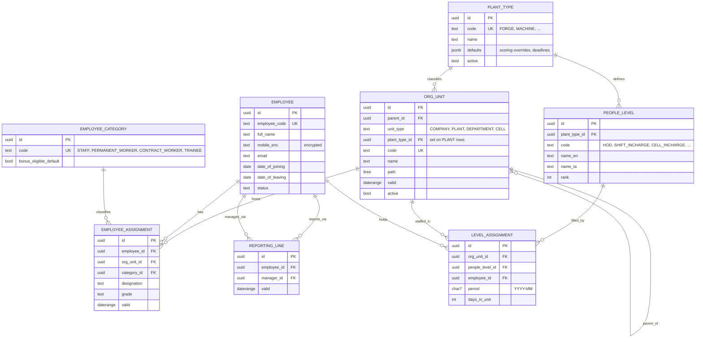
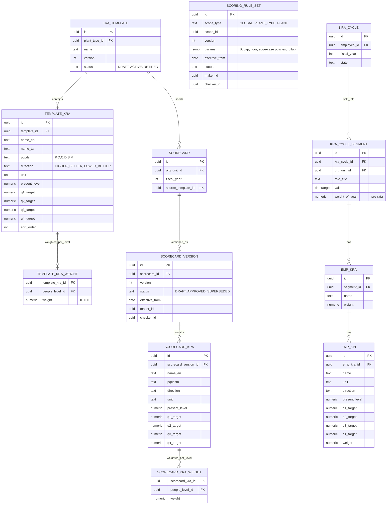
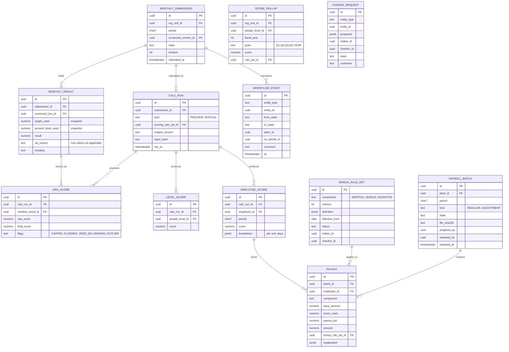
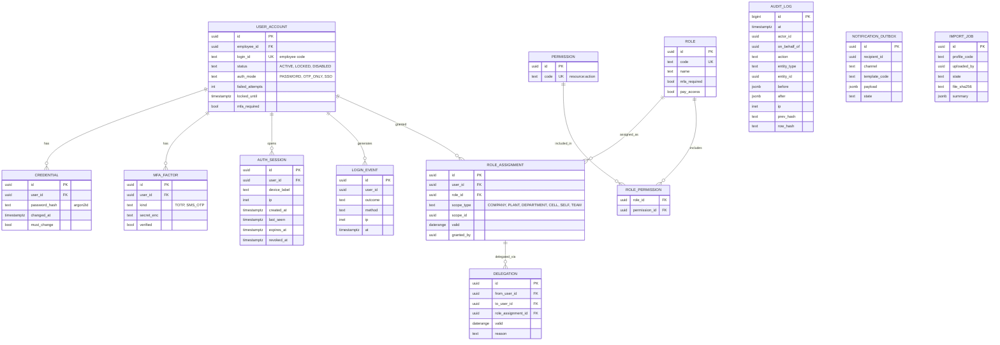

# 02 · Data Model

## 1. Conventions

- Primary keys are UUIDv7 (time-ordered). Business keys (employee code, org code) are unique constraints.
- **Effective-dated tables** carry `valid daterange` and an exclusion constraint such as `EXCLUDE USING gist (employee_id WITH =, valid WITH &&)` to prevent overlaps. Open-ended ranges are `[from,)`.
- **Immutable once used**: scorecard versions, rule sets and calculation runs are insert-only. Changes create a new version.
- Standard audit columns on all mutable tables: `created_at, created_by, updated_at, updated_by, version`.
- JSONB is used only where the shape is configuration (rule parameters, layout profiles) and is validated against a JSON Schema at write time.
- Pay data lives in a separate schema `pay` (own DB role, see doc 04 and 09). Everything else is in `core`.
- Hierarchy lookups use `ltree` paths on `org_unit` (maintained by trigger) for fast "all descendants of plant X".

## 2. ERD 1: Organisation, people, reporting, levels

Key rules:
- `ORG_UNIT` is a tree: COMPANY → PLANT → DEPARTMENT → CELL. A forge-shop plant uses DEPARTMENT units; a machine-shop plant uses CELL units under a DEPARTMENT ("Measuring Shop"). The scorecard attaches to the **leaf unit that is scored** (department or cell). That attachment point is a flag `is_scoring_unit` per plant type, so new plant types need no code.
- `EMPLOYEE_ASSIGNMENT` and `REPORTING_LINE` are independent effective-dated histories. A person can report to someone outside their org unit.
- `LEVEL_ASSIGNMENT` is **monthly** and holds `days_in_unit` to support mid-month transfers. Unique on `(org_unit_id, employee_id, period)`.
- Exclusion constraints prevent two active assignments overlapping for the same employee, except where the business allows dual assignment (flagged).

## 3. ERD 2: Templates, scorecards, rules, Module A

Key rules:
- A **scorecard** is created for a unit by copying the active template for its plant type. The plant may adjust present levels and targets (maker: Plant HR, checker: Plant Head); each approved change is a new `SCORECARD_VERSION`.
- Weights per level must total **exactly 100** across the scorecard's KRAs (deferred constraint checked at version approval).
- `SCORING_RULE_SET` resolution: most specific scope wins (PLANT → PLANT_TYPE → GLOBAL), then latest `effective_from` ≤ period start.
- Module A **segments** model mid-year joiners, transfers and role changes: each segment has its own KRAs/KPIs and a `weight_of_year` (pro-rata days). See doc 06.
- Quarterly targets are stored as columns because there are always four; this keeps the calculation set-based. If a client later wants other cadences, convert to a child table.

## 4. ERD 3: Monthly results, scores, workflow, variable pay

Key rules:
- `MONTHLY_RESULT` snapshots `target_used` and `present_level_used`, so reading an old month never depends on the current scorecard.
- Only the latest **OFFICIAL** `CALC_RUN` per submission feeds payouts. `PREVIEW` runs are ephemeral, pruned after the period closes.
- `PAYOUT` stores an `explanation` JSON (rule version, band hit, pro-rating factor), so any rupee can be explained.
- `SCORE_ROLLUP` is a derived table, rebuilt for the affected unit and quarter when a submission locks or reopens. Dashboards read only from it.
- `PAYROLL_BATCH` and `PAYOUT` live in the `pay` schema.

## 5. ERD 4: Identity, access, audit, integration

## 6. Constraints that protect integrity

| Constraint | Mechanism |
|---|---|
| No overlapping effective ranges per employee/unit | `EXCLUDE USING gist` |
| Level weights total 100 per scorecard version | Deferred constraint trigger on version approval |
| Direction vs target sanity (target on the improving side of PL) | Check in service and trigger on approval |
| Maker ≠ checker on rule sets, scorecard versions, change requests, submissions | Constraint trigger comparing actor IDs |
| One OFFICIAL calc per submission revision | Partial unique index |
| Locked submissions are read-only | Trigger rejects UPDATE/DELETE on results when `state ≥ LOCKED` unless a reopen is active |
| Audit log append-only | No UPDATE/DELETE grants; hash chain verified nightly |
| Pay schema isolated | Separate DB role; app connects with scoped role per request type |

## 7. Retention

| Data | Retention (default; confirm with client/legal) |
|---|---|
| Scores, payouts, payroll files | 8 years (statutory pay records) |
| Audit log | 8 years, archived to cold storage after 2 |
| Login events | 2 years |
| Uploaded Excel files | 2 years, then deleted; file hash kept |
| Departed-employee PII | Minimised after retention period (DPDP), results kept pseudonymised |
