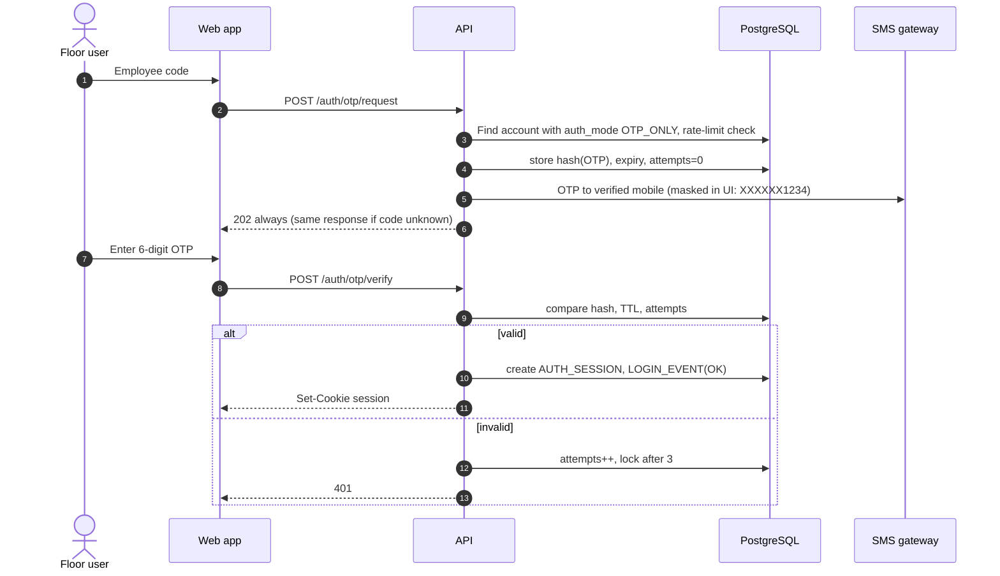
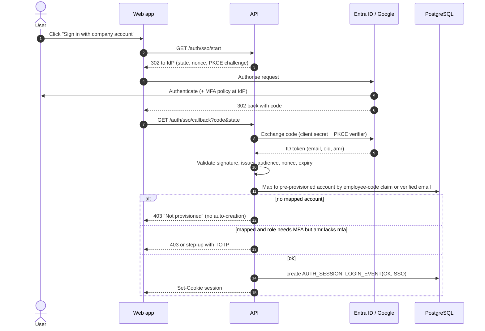

# 03 · Authentication Design

## 1. Goals

Floor staff may have no corporate email and share tablets, while HR and management handle pay data. Authentication therefore has three paths, selected per user (`auth_mode`) and constrained by role:

| Path | Who | Factors |
|---|---|---|
| **Password + MFA** | HR, admin, management, plant heads | Employee code + password, then TOTP (preferred) or SMS OTP. **MFA mandatory.** |
| **Mobile OTP primary** | Supervisors, setters, staff without email | Employee code, then OTP to the verified registered mobile. |
| **SSO (optional)** | Anyone with Entra ID/Google | OIDC authorisation-code + PKCE. MFA enforced at the IdP; portal verifies the `amr`/`acr` claim for mandatory-MFA roles. |

## 2. Policies (all configurable in System Config)

| Policy | Default |
|---|---|
| Password length / quality | ≥ 10 characters, checked against a breached-password list; no composition rules; no periodic expiry except privileged roles (180 days) |
| Hashing | Argon2id (memory-hard), per-user salt, pepper in KMS |
| Lockout | 5 consecutive failures → 15-minute lock, escalating; admin unlock; alerts to the user |
| OTP | 6 digits, 5-minute TTL, single use, stored hashed, max 3 verification attempts, 60 s resend gap, 5 OTPs/hour/user |
| Session | HttpOnly + Secure + SameSite=Lax cookie, **server-side** session; idle timeout 20 min (privileged 15, shared tablets 10), absolute 10 h |
| Concurrent sessions | Max 3; list and revoke from "My devices"; admin **forced logout** by user or by role |
| Step-up | Re-authentication (password/OTP) for sensitive actions: release payroll, approve rules, reopen, change roles |
| Device trust | Optional "remember this device 30 days" for OTP-primary users on personal phones; disabled on shared kiosks |
| Mobile number change | Requires OTP to old and new numbers, or admin-assisted with Co-HR approval; audited |

## 3. Login (password + MFA)

```mermaid
sequenceDiagram
  autonumber
  actor U as User
  participant SPA as Web app
  participant API as API (Identity module)
  participant DB as PostgreSQL
  participant SMS as SMS gateway
  U->>SPA: Employee code + password
  SPA->>API: POST /auth/login
  API->>DB: Load account, check status/lock
  alt locked or disabled
    API-->>SPA: 423 generic message (no detail leaked)
  else active
    API->>API: Verify Argon2id hash (constant time)
    alt wrong password
      API->>DB: failed_attempts++, LOGIN_EVENT(FAIL)
      API-->>SPA: 401 generic error
    else correct
      alt MFA required
        API->>DB: create pre-auth token (5 min, single use)
        API-->>SPA: 200 mfa_required {methods}
        U->>SPA: TOTP code (or request SMS OTP)
        opt SMS OTP chosen
          API->>SMS: send OTP (DLT template)
        end
        SPA->>API: POST /auth/mfa/verify
        API->>DB: verify code, reset failed_attempts
      end
      API->>DB: create AUTH_SESSION, LOGIN_EVENT(OK)
      API-->>SPA: Set-Cookie session; 200 profile + roles
    end
  end
```

## 4. Mobile OTP login (floor staff)



OTP-only users **cannot** hold roles flagged `mfa_required` (HR/admin/management). A role-assignment guard blocks that combination.

## 5. SSO (OIDC)



No just-in-time user creation: access is always granted by an admin plus role assignment, because scope must be assigned deliberately.

## 6. Password reset

```mermaid
sequenceDiagram
  autonumber
  actor U as User
  participant SPA as Web app
  participant API as API
  participant DB as PostgreSQL
  participant SMS as SMS gateway
  U->>SPA: Forgot password, enter employee code
  SPA->>API: POST /auth/reset/request
  API-->>SPA: 202 (identical response whether or not the code exists)
  API->>SMS: OTP to registered mobile (and email if present)
  U->>SPA: OTP + new password
  SPA->>API: POST /auth/reset/confirm
  API->>DB: verify OTP, validate password policy and history (last 5)
  API->>DB: store new hash, revoke ALL sessions, LOGIN_EVENT(RESET)
  API-->>SPA: 200; notify user by SMS/email "password changed"
```

**Admin-assisted reset:** Corporate HR (not Admin) can trigger a reset for a user who lost their mobile. The flow issues a one-time temporary credential delivered to the **reporting manager and the user's registered email**, requires `must_change` on first login, and records both actor and approver in the audit log. Admin can disable/enable accounts and revoke sessions but not read or set passwords.

## 7. Session and device management

- "My devices" page lists active sessions (device label, IP, last seen) with revoke.
- Admin forced logout by user, role, or plant (for incidents).
- Session rotation on privilege change (role assignment, step-up).
- CSRF: SameSite cookies plus a double-submit token on state-changing requests.
- Rate limiting by IP + account on all `/auth/*` endpoints; CAPTCHA after repeated failures.

## 8. Audit events (all written to LOGIN_EVENT and AUDIT_LOG)

Login success/failure (method, IP, user agent), MFA success/failure, OTP sent/verified, lockout/unlock, password change/reset, session revoke/forced logout, SSO mapping failures, role grants/revokes, delegation create/expire, step-up success/failure, mobile number changes. Alerts: ≥ 10 failures/min globally, impossible-travel for privileged roles, logins outside configured hours for payroll roles.
