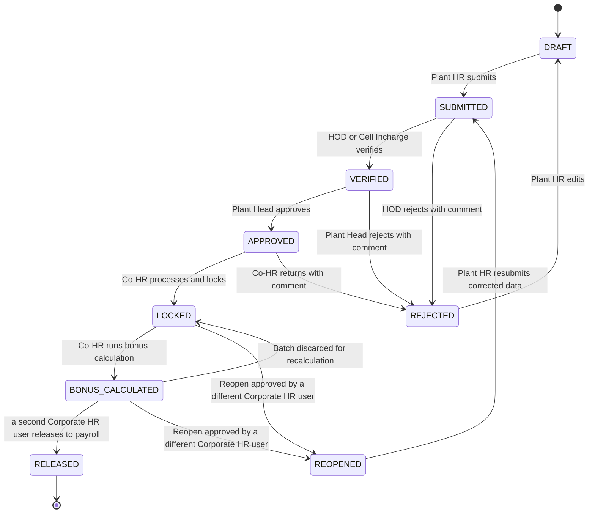
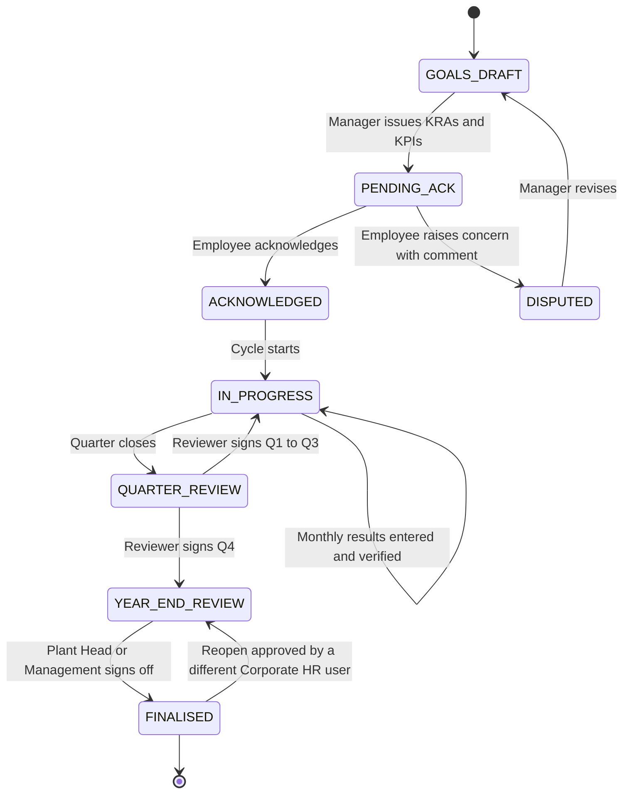
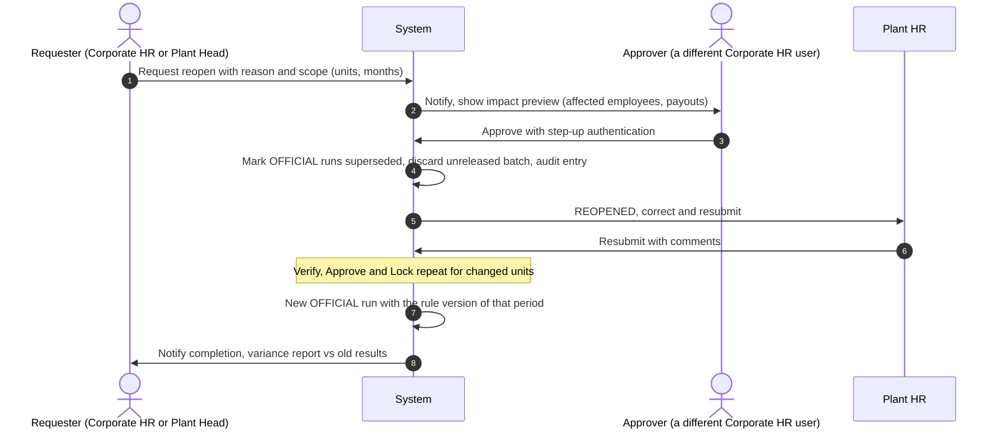

# 06 · Workflow State Machines

## 1. Module B: monthly cycle (per scored org unit per month)

A **monthly submission** exists per scored unit (department or cell) per period. The first four states are per unit; the last three are normally processed per plant-month batch.

### Transition table

| From → To | Actor (role·scope) | Guard | Comment | Side effects |
|---|---|---|---|---|
| DRAFT → SUBMITTED | PHR·P | All required KRAs have a result or an N/A reason; validation errors cleared; outlier comments present | optional | Preview calc stored; notify HOD |
| SUBMITTED → VERIFIED | HOD·D | Actor never edited this submission | optional | Notify Plant Head |
| SUBMITTED → REJECTED | HOD·D | n/a | **mandatory** | Notify Plant HR |
| VERIFIED → APPROVED | PH·P | Actor not in earlier chain; all units of the plant verified (or per-unit approval allowed by config) | optional | Notify Co-HR |
| VERIFIED → REJECTED | PH·P | n/a | **mandatory** | Notify Plant HR and HOD |
| REJECTED → DRAFT | PHR·P | n/a | n/a | Revision counter increments |
| APPROVED → LOCKED | CHR·C | Actor not in earlier chain; no open validation flags without acknowledgement | optional | Create OFFICIAL calc run, write scores, refresh `SCORE_ROLLUP`, freeze inputs |
| APPROVED → REJECTED | CHR·C | n/a | **mandatory** | Notify Plant HR |
| LOCKED → BONUS_CALCULATED | CHR·C | Salary-structure and attendance sheets present for the plant | n/a | Create payroll batch in `pay` schema with payouts |
| BONUS_CALCULATED → RELEASED | CHR·C (not the preparer) | Preparer ≠ releaser; step-up auth | optional | Generate file, SHA-256, notify Plant HR and Plant Head |
| LOCKED / BONUS_CALCULATED → REOPENED | CHR·C (a different user from the requester; request by CHR or PH) | Not RELEASED; reason + scope of change | **mandatory** | Supersede OFFICIAL run, delete unreleased batch, notify chain |
| REOPENED → SUBMITTED | PHR·P | Changed rows carry comments | **mandatory** | Verification and approval repeat for the changed units |

### Rules

- **Rejection always requires a comment** and is shown in the submission timeline.
- **Revisions**: every REJECTED/REOPENED cycle increments `revision`; the previous revision's inputs stay readable.
- **No self-approval**: enforced by DB trigger (doc 04).
- **Per-unit vs per-plant processing**: Verify is per unit. Approve may be bulk for all units in a plant (single click, still one workflow event per unit). Lock, bonus and release operate on the plant-month; a plant-month can lock only when all its units are APPROVED (or explicitly excluded with reason).
- **Concurrency**: transitions use optimistic locking on `revision`; a stale client gets 409.

### After release: corrections

`RELEASED` is terminal for the original batch. If an error is found afterwards, Co-HR opens an **adjustment**: it creates a new REOPENED revision *and* an `ADJUSTMENT` payroll batch containing only the deltas (signed), with the same approval. The original file stays untouched for audit.

## 2. Deadlines, reminders, escalation (all configurable per plant type)

| Step | Default due (working day of next month) | Reminder | Escalation if missed |
|---|---|---|---|
| Plant HR submits | WD 3 | WD 2 (to PHR) and on the day | WD 4: notify Plant Head; WD 5: notify Co-HR |
| HOD verifies | WD 4 | On receipt, then day before | +1 day: Plant Head; +2 days: Co-HR |
| Plant Head approves | WD 5 | On receipt, then day before | +1 day: Co-HR; +2 days: Management digest |
| Co-HR processes and locks | WD 7 | Day before | Digest to Corporate HR |
| Bonus calculation | WD 8 | n/a | Digest to Corporate HR |
| Payroll release | WD 10 | Day before | Management digest |

- A scheduled worker job evaluates deadlines hourly (IST) and writes to the notification outbox.
- Holiday calendars per plant; deadlines skip non-working days.
- If an approver is on approved delegation, reminders go to the delegate.
- Channels: in-app always; email by default; SMS or WhatsApp for floor roles and for escalations (templates registered under DLT / approved with the BSP).

## 3. Module A: senior-staff KRA cycle (per employee per fiscal year)

| Step | Actor | Notes |
|---|---|---|
| Goal setting | Manager (HOD·T, PH·P, MGMT·T for direct reports); Co-HR can seed from a **senior-role template** | KRAs and KPIs each with unit, direction, present level, Q1–Q4 targets, weightage. KRA weights total 100; KPI weights total 100 within each KRA. |
| Acknowledgement | Employee (EMP·S) | Acknowledge or dispute with comment; the acknowledgement timestamp and version are stored. |
| Monthly result entry | Employee drafts (optional), manager enters or confirms; reviewer verifies | Same scoring engine (B, cap, floor configurable for Module A as its own rule scope `SENIOR`). |
| Quarterly / yearly | Roll-up: KPI scores → KRA score (weighted) → total (weighted) → quarter average → year | Rating bands and increment guidelines are config. |
| Sign-off | Assigned reviewer (an HOD / Manager, Plant Head or Management user, `·As`), then Plant Head or Management | Final rating locks the cycle. |

### Mid-year joiners, transfers, role changes

- A KRA cycle is divided into **segments** (`KRA_CYCLE_SEGMENT`), each with its own org unit, role title, KRAs/KPIs and `valid` date range.
- **Joiner on date D**: one segment from D to year end; `weight_of_year = days / total days`; the first-quarter score counts only months present; quarters with no active month are excluded from the average.
- **Transfer or role change on date D**: current segment closes at D−1; a new segment opens at D in `GOALS_DRAFT` (new KRAs, acknowledged again). Year score = Σ(segment score × weight_of_year).
- **Leavers**: cycle closes at the last working day; the final score is pro-rated and flagged "partial".
- Effective dates come from `EMPLOYEE_ASSIGNMENT`, so org changes and KRA segments stay consistent, and a transfer in Module B updates `LEVEL_ASSIGNMENT.days_in_unit` the same way.

## 4. Controlled reopen (both modules)

If the month was already **RELEASED**, the reopen additionally generates an adjustment batch (section 1).
