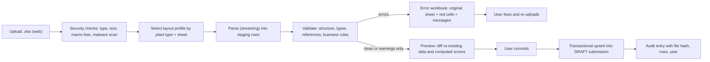

# 08 · Excel Import and Export

## 1. Principles

- The portal must accept the **client's existing PMS sheet layout**, so Plant HR does not re-key data during transition.
- Imports are **two-step**: upload → validate (nothing saved) → review errors → commit atomically. A partial commit never happens.
- Layouts are **configuration** (layout profiles), so a new plant type's format is added without code changes.
- All uploads are untrusted input (doc 09).

## 2. Import pipeline



Import jobs run in the worker; the UI polls `GET /imports/{id}`.

## 3. Layout profiles

A profile is JSON stored in `import_profile` (versioned, maker-checker):

```json
{
  "code": "PMS_MACHINE_V1",
  "plantType": "MACHINE",
  "sheetPattern": "^(MAG|TML|ISUZU|M&M|Cross & Spider|Yoke & ZF)$",
  "unitFromSheetName": true,
  "headerRow": 4,
  "firstDataRow": 6,
  "columns": {
    "kraName":      { "col": "B", "required": true },
    "pqcdsm":       { "col": "C", "required": true, "map": { "Productivity": "P", "Quality": "Q" } },
    "direction":    { "col": "D", "map": { "Higher": "HIGHER_BETTER", "Lower": "LOWER_BETTER" } },
    "unit":         { "col": "E" },
    "presentLevel": { "col": "F", "type": "number" },
    "targets":      { "q1": "G", "q2": "H", "q3": "I", "q4": "J" },
    "weights":      { "CELL_INCHARGE": "K", "SETTER_SUPERVISOR": "L", "STAFF": "M" },
    "monthlyResult": { "colByMonth": { "2026-04": "N", "2026-05": "O" } }
  },
  "ignore": { "formulaColumns": ["S", "T"], "note": "Excel-computed scores are read for reconciliation only" }
}
```

Imports of other kinds use their own profiles: `EMPLOYEES`, `ORG`, `LEVEL_ASSIGNMENTS`, `ATTENDANCE`, `SALARY_STRUCTURE`, `SCORECARD` (targets, PLs, weights), `MONTHLY_RESULTS`, and `PMS_MIGRATION_FY2026`.

**Reconciliation mode** (used during migration and parallel run): the importer also reads the Excel's own computed score columns and compares them to the engine output, listing differences per KRA (expected where the sheet had unbounded or wrong scores).

## 4. Validation rules

| Code | Level | Rule |
|---|---|---|
| FILE-001 | error | Not .xlsx, over 25 MB, macro-enabled, password-protected, or corrupt |
| FILE-002 | error | No matching layout profile / sheet not recognised |
| FILE-003 | error | Same file hash already committed for the same unit and period |
| STR-001 | error | Required column or header missing (cell reference shown) |
| STR-002 | error | Merged cells or hidden rows in the data region |
| TYPE-001 | error | Non-numeric value in a numeric column (text, error cell such as `#DIV/0!`) |
| TYPE-002 | error | Value outside unit range (e.g. % > 100 where unit is %) |
| REF-001 | error | Unit, cell, department or employee code not found / not in the user's scope |
| REF-002 | error | Employee not assigned to the unit in that period |
| REF-003 | error | Unknown people level name |
| KRA-001 | error | KRA does not exist in the unit's approved scorecard version (for monthly results) |
| KRA-002 | error | Target contradicts direction (higher-better target < PL; lower-better target > PL) |
| KRA-003 | error | Weights for a people level do not total 100 |
| KRA-004 | error | Duplicate KRA names in a sheet |
| KRA-005 | warning | Plant type PQCDSM category missing (e.g. no Safety KRA) |
| RES-001 | error | Result missing without an N/A reason |
| RES-002 | warning | Outlier (computed raw score outside −100..200, or result > 3× PL or beyond 3 MAD of the last 6 months) |
| RES-003 | warning | Target in file differs from approved scorecard (the scorecard wins unless "override target" is permitted by config, then comment required) |
| RES-004 | error | Period not open, or submission not in DRAFT/REJECTED/REOPENED |
| EMP-001 | error | Duplicate employee code in file |
| EMP-002 | error | Mobile number invalid (10 digits, India) |
| EMP-003 | error | Reporting-line cycle detected |
| EMP-004 | warning | Employee already assigned elsewhere in the period (dual assignment needs explicit days split) |
| ATT-001 | error | Attendance days > working days of month |
| PAY-001 | error | Base amount missing or negative for an employee eligible under the active bonus rule |

Errors block commit; warnings need an acknowledgement.

**Error workbook:** a copy of the user's sheet with offending cells highlighted, a new "Portal messages" sheet (row, column, code, message in English/Tamil, suggested fix) and a summary tab.

## 5. Exports

| Export | Format | Content | Access |
|---|---|---|---|
| Monthly PMS sheet per department/cell | .xlsx in the client's familiar layout | KRAs, PL, targets, results, KRA scores, level scores, flags | Scoped to unit |
| Quarterly / yearly summaries | .xlsx, .pdf | Per level, per unit, per plant; plant-vs-plant within type | Scoped; Management/Corporate HR company-wide |
| **Payroll file** per plant and consolidated | .xlsx and .csv with configurable columns | employee code, name, plant, component, base, score, %, amount, rule version, batch ID | Pay roles only; step-up; watermarked; logged |
| Exception report | .xlsx | Missing scores, no weights, gaps, ineligible employees | Co-HR |
| Audit extract | .csv | Filtered audit rows | Corporate HR (business) / Admin (system) |
| Individual statement | PDF | Own scores and bonus statement | Self |

Export safeguards:
- **Formula-injection protection**: any text cell beginning with `=`, `+`, `-`, `@` or tab is prefixed with `'`.
- Generated asynchronously for large sets, stored in object storage with a 24-hour signed URL, then purged; every download is logged.
- Payroll files carry a **trailer row** (record count, total amount) and a stored SHA-256.
- Column map and number formats per exporter configuration (decimal places, date format `DD-MM-YYYY`, code padding) so the payroll team can match their loader.

## 6. Migration of 2026-27 PMS data

1. **Collect**: the actual workbooks for all 12 plants (April to current month).
2. **Profile**: build and test layout profiles per plant type; log every irregularity (merged cells, notes in numeric columns, renamed sheets).
3. **Master data first**: org units, employees, people-level assignments (from `EMPLOYEES`, `ORG`, `LEVEL_ASSIGNMENTS` sheets).
4. **Scorecards**: import PL, targets and weights per unit, then validate (KRA-002/003).
5. **History**: import each past month as a LOCKED, `source = MIGRATION` submission with the original Excel stored as an attachment; reconciliation mode compares engine scores to the Excel scores and the client signs off the differences.
6. **Parallel run** for one cycle (pilot plants): Plant HR works in both systems, Co-HR compares outputs.
7. **Cut-over** plant by plant using the per-org-unit feature flag.

## 7. Performance and limits

- Streaming parse (constant memory), row batches of 500 into staging; a 5,000-row workbook validates in seconds.
- Limits: 25 MB, 50 sheets, 20,000 rows per sheet; concurrency: 3 import jobs per plant.
- Idempotent re-upload: the same file hash and target is rejected (FILE-003); a modified file creates a new revision.
