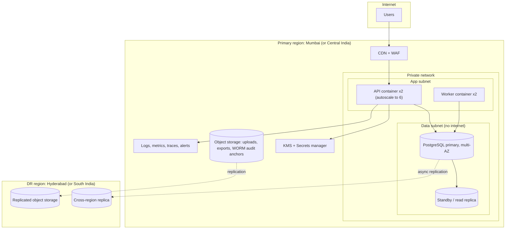

# 10 · Deployment, Environments, Backup, Monitoring

## 1. Topology (recommended: managed cloud, India region)

Runtime: containers on a managed service (Azure Container Apps / AWS ECS Fargate) with the SPA served as static files via the CDN. A single-VM Docker Compose option exists for UAT and for an on-prem fallback.

## 2. Environments

| Environment | Purpose | Data | Notes |
|---|---|---|---|
| Local / dev | Developer machines, ephemeral PR previews | Synthetic seed | Docker Compose with Postgres |
| **Test (CI)** | Automated tests on each PR | Synthetic + golden-file fixtures | Ephemeral DB per run |
| **UAT** | Client acceptance, parallel run rehearsal | Anonymised copy of real structure; pilot plants' real Excel for migration rehearsals under NDA | Production-like sizing at 25%, SMS/WhatsApp in sandbox mode |
| **Production** | Live | Real | Change-controlled, break-glass access only |
| DR | Standby | Replicated | Failover runbook tested twice a year |

Config is per environment via IaC variables and the secret manager; same container image promoted across environments.

## 3. CI/CD

1. PR: lint, typecheck, unit tests (including `@mmf/scoring` golden suite), SAST, dependency/secret scan.
2. Merge to main: build signed image, run integration tests (DB with migrations, authorisation matrix, SoD tests), push to registry.
3. Auto-deploy to UAT; smoke tests.
4. Manual approval (two approvers) → production, blue/green or rolling with health checks; automatic rollback on failed readiness.
5. **Database migrations**: forward-only, backwards-compatible (expand → migrate → contract), run as a separate job before app rollout; destructive migrations need an explicit approval.
6. **Release calendar rule**: no production deployments during the month-end processing window (WD 1–10), except hot-fixes approved by Corporate HR and engineering lead.

## 4. Capacity

| Item | Expectation | Provisioning |
|---|---|---|
| Users | ~5,000 total; 50–200 concurrent; month-end peak | 2 API + 2 worker containers (2 vCPU, 4 GB each), autoscale on CPU/latency |
| DB size | Year 1 under 5 GB of core data, plus audit growth of about 1 GB/yr | Managed Postgres, 4 vCPU / 16 GB, storage autoscale |
| Dashboards | < 2 s | Reads from `SCORE_ROLLUP` and indexed tables; read replica for reporting; CDN for static assets |
| Monthly scoring + bonus, all plants | < 1 min (expected seconds) | Per-plant parallel worker jobs |
| Growth | 20+ plants | Horizontal app scaling; DB headroom > 10× |

## 5. Backup and disaster recovery

| Item | Target |
|---|---|
| **RPO** | ≤ 5 minutes (WAL archiving, PITR) in-region; ≤ 15 minutes cross-region |
| **RTO** | ≤ 1 hour for in-region failure (multi-AZ failover); ≤ 4 hours for region loss |
| Backups | Daily full snapshot + continuous WAL; retention 35 days PITR, monthly snapshots kept 1 year, year-end snapshots 8 years |
| Object storage | Versioning + cross-region replication; uploads lifecycle 2 years; WORM bucket for audit anchors |
| Encryption | All backups encrypted with KMS keys; keys backed up separately |
| **Restore tests** | Quarterly: restore to an isolated environment, run integrity checks (audit hash chain, row counts, a golden calculation) and record timings |
| Application state | Stateless; sessions are in the DB, so no loss on container restart |

Runbooks: failover, point-in-time restore ("undo a bad migration"), key rotation, secret leak, mass-OTP-abuse, import-job stuck, month-end late processing.

## 6. Monitoring, logging, alerting

- **Metrics** (Prometheus/OTel): request rate, latency percentiles, error rate, DB connections/locks/replication lag, queue depth and job age, calc-run duration, import duration, login failures, SMS delivery success.
- **Logs**: structured JSON with request ID, user ID (not name), no PII or pay values; centralised, 1-year retention; audit log is separate and permanent.
- **Tracing**: OpenTelemetry across API → worker → DB for slow-path analysis.
- **Frontend**: Sentry for errors with PII scrubbing.
- **Uptime**: synthetic checks on login and a read-only scoring page every minute from outside.

### SLOs and alerts

| SLO | Target | Alert |
|---|---|---|
| Availability (business hours 7 am–9 pm IST, Mon–Sat) | 99.5% | Page on 5-minute outage |
| API p95 latency | < 500 ms; dashboards < 2 s | Warn at 1 s sustained |
| Official calc run (all plants) | < 60 s | Warn at 30 s |
| Notification delivery | 99% within 5 minutes | Warn on queue age |
| Job failures | 0 stuck jobs | Page on job age > 15 minutes at month-end |
| Security | n/a | Page on audit chain break, repeated privileged-role failures, bulk export of pay data |

Maintenance windows: Sundays 22:00–02:00 IST, never during WD 1–10.

## 7. Cost shape (indicative; to be validated with a provider quote)

Small: ~4 container instances, one managed Postgres with standby, storage, CDN/WAF, KMS, monitoring, DR replica. Main variable cost is SMS/WhatsApp (OTP + notifications for ~5,000 users). On-prem option swaps cloud services for client hardware plus the same container images and Postgres with pgBackRest, and shifts patching, backup and DR effort to the client IT team.

## 8. Housekeeping jobs

Nightly: audit-chain verification, session cleanup, expired-OTP purge, backup verification report.
Monthly: deadline calendar generation, retention enforcement, preview-calc pruning.
Quarterly: restore test, access recertification (list of all role assignments for Corporate HR and department heads to confirm or revoke).
