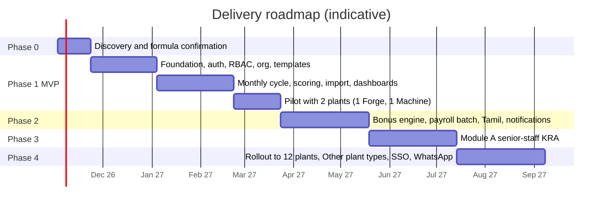

# 11 · Phased Delivery Plan

Estimates assume a team of about 6: 2 backend, 2 frontend, 1 QA/automation, 1 shared BA/PM and DevOps, plus client SMEs available weekly. Durations are indicative and will be firmed up after Phase 0.

## Phase summary

## Build slice order (revised) and the hardening release gate

Phase 1 is built as vertical slices, each delivered with its API and automated tests and closed by a sign-off before the next starts:

| # | Slice | Status |
|---|---|---|
| 1 | Foundation: monorepo, `@mmf/scoring`, Postgres schema, login, sessions, RBAC, hash-chained audit log, dev seed | Done |
| 2 | Org and employee management; KPI library and KRA templates with weight-per-level validation (maker-checker activation, immutable versions) | Done |
| 3 | Monthly data entry with validation, and the approval workflow (Draft → Submitted → Verified → Approved → Locked, rejection and reopen paths); per-unit scorecard snapshot from the active template; official scores at lock | Done (awaiting sign-off) |
| 4a | Plant-level scorecard adjustments with approval (new immutable version from a chosen month), plant-month bulk approve and lock with reasoned exclusions, quarter/year roll-ups, plant status board, management plant-vs-plant view | Done (awaiting sign-off) |
| 4b | Excel export and import (needs the client's real PMS layouts), deadlines, reminders and escalation worker, notifications outbox | Planned |
| 5 | **Hardening** (see below) | **Release gate** |

### Release gate: hardening slice

The following are deliberately deferred while slices 2 to 4 are built, and **must all be complete and verified before any production deployment, including a pilot that uses real employee or pay data**. A deployment that skips any item is not permitted.

- **Strong authentication:** TOTP/SMS OTP MFA enforced for every `mfa_required` role (remove the dev-only `MFA_BYPASS` path entirely), mobile-OTP login for floor users, password reset (self-service and admin-assisted), step-up re-authentication for sensitive actions.
- **Abuse protection:** per-IP and per-account rate limiting on `/auth/*` and write endpoints, CAPTCHA after repeated failures, CSRF double-submit tokens on state-changing requests.
- **Database-level access control:** PostgreSQL row-level security on `core` tables keyed to the caller's allowed scope, the separate `pay` schema with its own DB role, and a test that scans repositories for unscoped queries (doc 04 §4).
- **Verification:** an external penetration test with no open high findings, a successful backup restore test, and a check that the audit hash chain verifies on the restored data.
- **Configuration safety:** startup refuses production mode with any dev-only switch enabled; secrets come only from the environment or a secret store.

Until this gate is closed the system is a development and demonstration build only.

## Phase 0: Discovery and design sign-off (≈ 3 weeks)

- Collect real PMS workbooks from all 12 plants; document each layout and all formula variants.
- Resolve the blocking open questions (doc 12): base score B per plant type, cap/floor, bonus and incentive formulas, the 3 "Other" plant types' formats, org and level definitions.
- Build the golden-file test set from real sheets.
- UX workshops with Plant HR, Co-HR and a Plant Head; clickable prototype (the existing demo is the starting point).
- **Exit**: signed requirements baseline, confirmed scoring rules for Forge and Machine, golden tests reconciling with Excel.

## Phase 1: MVP, "locked, auditable monthly scores" for Forge and Machine plants (≈ 18 weeks including a pilot)

In scope:
- Platform: environments, CI/CD, IaC, observability, backups.
- Identity: employee code + password, mobile OTP login, TOTP MFA for privileged roles, lockout, sessions, password reset, login audit.
- RBAC: roles, scopes, SoD checks, maker-checker framework, audit log with hash chain.
- Org: plant types, org tree, employees with categories, effective-dated assignments and reporting lines, people levels and monthly level assignments, bulk import from Excel.
- Templates and scorecards: per plant type, per-plant targets/PL adjustments with approval, weight validation.
- Scoring engine v1 with configurable B/cap/floor, edge cases, versioned rule sets.
- Monthly workflow: web forms and Excel upload, validation, Draft → Submitted → Verified → Approved → Locked, rejection paths, reopen, deadlines and email reminders.
- Dashboards: plant view (levels, gaps) and management view (plant-vs-plant within type, trends).
- Exports: monthly PMS sheet, score summaries, **provisional score file for payroll** (scores only, no amounts).
- Migration of FY 2026-27 data for the pilot plants with reconciliation report.
- English UI with i18n scaffolding and tablet layouts.

Out of scope for Phase 1: bonus/incentive calculation, Module A, SSO, Tamil content, SMS/WhatsApp (email and in-app only), Other plant types.

**Exit criteria**: pilot plants complete 1 full monthly cycle in the portal in parallel with Excel; engine output reconciles with Excel within agreed tolerance; security review and pen test with no open high findings; restore test passed.

## Phase 2: Variable pay and operations (≈ 8 weeks)

- Bonus and incentive rule engine (DSL, simulation, maker-checker), salary-structure and attendance imports.
- Payroll batches: calculation, variance report, approval, release, locked Excel/CSV, adjustment batches.
- Individual bonus statement for employees.
- Notifications: SMS (DLT) and WhatsApp adapters, escalation engine.
- Tamil translations for employee-facing and floor screens.
- Reopen-after-release flow with adjustments.

**Exit**: a month's bonus run on pilot plants matches Co-HR's manual calculation; payroll team accepts the file in their loader.

## Phase 3: Module A, senior-staff KRA (≈ 8 weeks)

- Senior-role templates, KRA/KPI authoring, acknowledgement and dispute, monthly entry, quarterly/yearly roll-up, reviews and sign-off.
- Mid-year joiner/transfer/role-change segments and pro-rating.
- Delegation and reviewer assignment UI.
- Dashboards for senior staff and management.

## Phase 4: Full rollout and extensions (≈ 8 weeks, overlapping rollout waves)

- Roll out remaining Forge and Machine plants in waves of 2–3 plants.
- Configure the 3 "Other" plant types (formats, levels, templates) via configuration.
- Optional SSO (Entra ID/Google), advanced analytics, data-quality dashboards.
- Payroll integration interface (SFTP/API) if the client's payroll system supports it.
- Hypercare and handover: admin training, runbooks, access recertification process.

## Key risks and mitigations

| Risk | Mitigation |
|---|---|
| Formulas and plant variants differ across the 12 plants | Phase 0 audit of real sheets; scoring parameters are per plant type/plant, not hard-coded |
| Bonus rules unknown or politically sensitive | Rule engine configurable with simulation; Phase 1 ships scores only |
| Messy Excel data | Layout profiles, error workbooks, reconciliation mode, patient pilot |
| Floor users with low digital familiarity | OTP login, tablet-first UI, Tamil, short training, champions in each plant |
| Month-end load and deadlines | Early reminders, per-plant parallel jobs, release freeze during WD 1–10 |
| Scope creep from "Other" plant types | Treated as configuration; anything needing new capabilities goes through change control |
| SMS/WhatsApp approval lead times (DLT, BSP) | Start registrations in Phase 0 |
